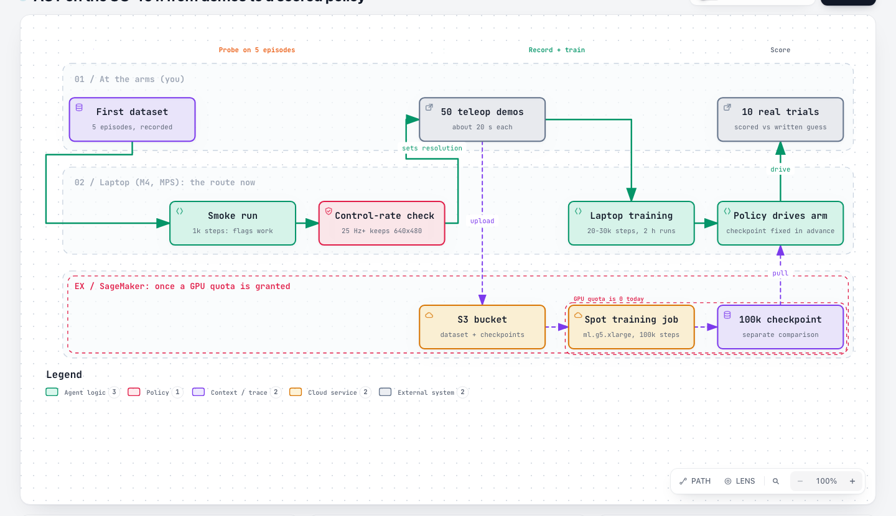
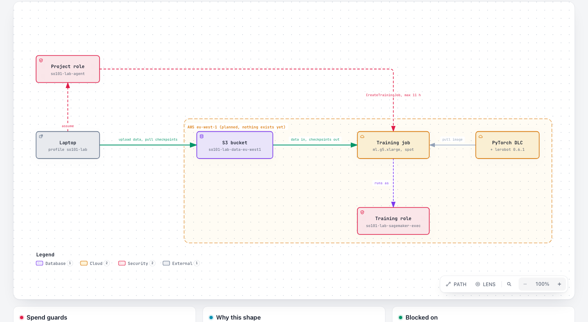

# Training plan: ACT with no GPU quota

How we get from recorded demos to a scored ACT policy (#68) while every AWS
GPU quota is 0. Written 2026-10-26 for #101; update it when a step lands or
the quota changes.

## The route

Train on the laptop now, in resumed runs of 2 h or less. The SageMaker
route below is built alongside and used once AWS grants a GPU quota. No
simulation and no pretraining of our own: ACT starts from an ImageNet
ResNet18.

## Why the laptop is enough for a first ACT

| Fact | Number | Kind | Source |
|---|---|---|---|
| ACT on an M2 Mac, batch 8 | 30k steps in 6 h 41 min (about 1.25 steps/s) | measured elsewhere | [classmethod, Mac training][mac] |
| Success by checkpoint, 30 SO-101 episodes, 10 trials each | 5k: 0/10, 10k: 6/10, 15k: 8/10, 20k: 10/10, 30k: 9/10 | measured elsewhere | same |
| Same task family, 50 episodes, 100k steps, CUDA | 9/10 | measured elsewhere | [classmethod, eval][eval] |
| Our M4, per 2 h run | about 9k-14k steps | estimate (M2 figure scaled) | - |
| Runs to reach 20k-30k steps | 2-4, resumed from `checkpoints/last` | estimate | - |

Loss does not predict success ([forum][forum]), so the checkpoint that
counts is fixed before training, never picked by its score. #76 fixed it
as `last` at 100k steps, which the laptop cannot reach; #76 changes it
before any training. Proposed: the 20k-step checkpoint counts against the
expectation, 10k, 15k and 30k are reported alongside, and a later 100k
SageMaker checkpoint is a separate comparison.

## The one laptop risk: control rate

The policy must run the loop (read camera and joints, predict, send to the
servos) close to the 30 fps the demos were recorded at. A MacBook Pro M4
with 2 cameras at 640x480 managed about 15 Hz and scored 4/10, against 9/10
on CUDA ([eval]). We have 1 camera. We measure our rate with the smoke-run
checkpoint, trained on the 5 episodes already recorded, before recording
the 50 demos. Under 25 Hz: record the 50 demos at 320x240, which ACT in LeRobot 0.6.1 cannot do by resizing at train time
(no resize option in `ACTConfig`; checked in the installed source).

## The SageMaker route (once a GPU quota exists)

| Piece | Choice | Why |
|---|---|---|
| Instance | ml.g5.xlarge (A10G, 24 GB), managed spot | fits ACT and later SmolVLA; spot is 50-70% off |
| Image | stock AWS PyTorch training image + `lerobot==0.6.1` | no image to build or store |
| Data | S3 bucket, input channel | dataset in, checkpoints out every 5k steps |
| Resume | `checkpoint_s3_uri`, `--resume=true` when a checkpoint exists | spot can stop a job |
| Video | `--dataset.video_backend=pyav` | torchcodec fails on the image's FFmpeg |
| Guard | max run 11 h | 11 h x USD 1.57 (on-demand price, AWS Price List via aws-manager) = about EUR 15, the per-run limit |

A public, MIT-licensed example does exactly this
([furuya02/soarm101-lerobot-sagemaker-il][sm]): 30k steps on ml.g5.2xlarge
billed about EUR 0.80 on spot.

## Costs

Approx. EUR 1 = USD 1.15. Spend so far this month: EUR 1.29 (USD 1.48), all
accounts.

| Route | Per ACT run | Monthly standing cost |
|---|---|---|
| Laptop, 20k-30k steps | EUR 0 | 0 |
| SageMaker g5.xlarge spot, 100k steps | about EUR 2-3 (estimate) | bucket about EUR 0.10-0.40 |
| SageMaker g5.xlarge on demand, 100k steps | about EUR 6 | same |
| SmolVLA later, spot | about EUR 4-7 (estimate) | same |

## GPU access today

| Request | State (2026-10-26) |
|---|---|
| SageMaker ml.g4dn.xlarge training, on demand | declined 2026-10-25 |
| SageMaker ml.g4dn.xlarge training, spot | open since 2026-10-14 |
| EC2 G and VT, 4 vCPU, on demand and spot | open since 2026-10-26 |
| SageMaker ml.g5.xlarge training, spot | not yet asked (#102, your call) |
| SageMaker Studio Lab (free T4) | closed to new sign-ups ([AWS docs][sl]) |
| Notebook or Studio GPU | separate quotas, all 0; no easier to get |

## Steps on the board

| Step | Item | Blocked by |
|---|---|---|
| Write the task, the expected score and the checkpoint that counts | #76 | - |
| 1k-step smoke run on the 5 recorded episodes | #79 | #76 (the expectation is written before any training) |
| Measure the control rate with the smoke checkpoint | #81 | #79 |
| Record 50 demos (about 20 s each), resolution set by the rate | #78 | #76, #77, #81 |
| Train 20k-30k steps on the laptop | #104 | #78, #79 |
| Score 10 trials on the checkpoint fixed in #76 | #82 | #104, #81 |
| AWS bucket and roles | #103 | #102 |
| SageMaker launcher with a dry run | #105 | #79 |
| Full 100k-step run on SageMaker | #80 | quota, #103, #105 |

[mac]: https://dev.classmethod.jp/articles/so-arm101-duck-pick-imitation-learning-mac-training/
[eval]: https://dev.classmethod.jp/en/articles/lerobot-so-arm101-act-training-eval/
[forum]: https://discuss.huggingface.co/t/what-is-the-expected-success-rate-for-a-act-trained-model-using-50-episodes/178517
[sm]: https://github.com/furuya02/soarm101-lerobot-sagemaker-il
[sl]: https://docs.aws.amazon.com/sagemaker/latest/dg/studio-lab-availability-change.html

Diagram sources: `figures/2026-10-26-*.archify.json`, rendered with the archify skill.
